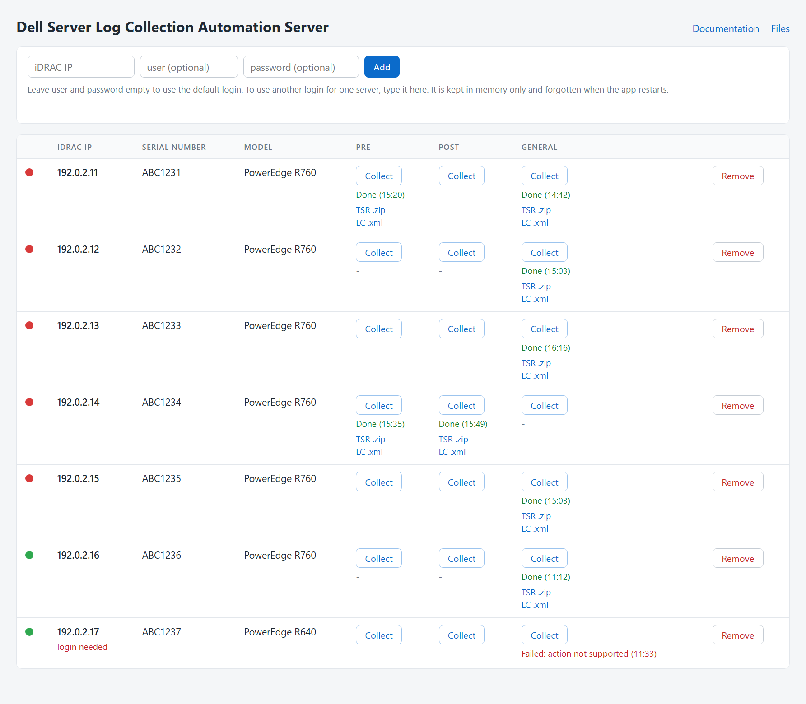

# Dell Server QA Automation

Collect the TSR and the Lifecycle log from Dell servers through the iDRAC Redfish API, from one dashboard. Built for Day-0 staging.

[Getting started](docs/getting-started.md) | [Usage](docs/usage.md) | [Configuration](docs/configuration.md) | [Operations](docs/operations.md) | [Troubleshooting](docs/troubleshooting.md) | [Changelog](CHANGELOG.md)



## Features

- One click per server: Collect under Pre, Post or General. No iDRAC web sessions.
- The TSR (a zip) and the Lifecycle log (an XML file) are saved under the server's Dell Service Tag, each with a SHA-256 checksum.
- Several servers in parallel, with live status per server and stage, and a status light per server.
- Download from the dashboard, or browse the files read-only with the `Files` link.
- Documentation built into the dashboard, so it works offline.
- Python only: FastHTML, SQLite and `requests`. No agent at run time and no change to iDRAC configuration.
- Runs in Docker on a Linux VM. Portable, and easy to rebuild.

## Install

On a fresh Ubuntu Server 26.04 VM (minimum 4 GB RAM, 4 cores, 128 GB disk) with internet access:

```bash
git clone https://github.com/MingFei2001/Dell-Server-QA-Automation.git
cd Dell-Server-QA-Automation
bash setup.sh
```

The script installs Docker if it is missing, asks for the iDRAC login, builds and starts the containers, and prints the dashboard address. Open it from a PC on the same network.

To install by hand, see [Getting started](docs/getting-started.md). The target servers need iDRAC firmware 7.00.00 or later ([Redfish calls](docs/redfish-reference.md)).

## Documentation

| Page | Covers |
|---|---|
| [Getting started](docs/getting-started.md) | Quick start, your first hour, iDRAC access |
| [Usage](docs/usage.md) | The dashboard, the files it saves and how they are named |
| [Configuration](docs/configuration.md) | `.env` keys, syntax and recovery |
| [Operations](docs/operations.md) | Start, stop, update, back up and roll back |
| [Troubleshooting](docs/troubleshooting.md) | Symptoms and fixes |
| [Architecture](docs/architecture.md) | Scope, software stack, hosting, design reasons, how it works |
| [Redfish calls](docs/redfish-reference.md) | The API calls, with firmware compatibility |
| [Development](docs/development.md) | Project layout, code map, adapting to another vendor, testing |
| [Status](docs/status.md) | Current stage, verification record, open items |
| [Decisions](docs/decisions.md) | Decision log with reasons |
| [Changelog](CHANGELOG.md) | Version history |

The same pages are shown at `/docs` on the dashboard.

## Project layout

```
├─ main.py            the whole app: dashboard, collection worker, documentation pages
├─ static/            bundled htmx
├─ Dockerfile         app image
├─ compose.yaml       app and file browser services
├─ files.conf         file browser settings (read-only)
├─ setup.sh           set up a fresh Ubuntu VM
├─ .env.example       template for .env
├─ docs/              documentation (Markdown)
│  └─ slides/         demo deck and reference deck
├─ data/              evidence and database (not in git)
└─ CHANGELOG.md       version history
```

See [Development](docs/development.md) for every file.

## Status

Proof of concept complete: the TSR and the Lifecycle log were collected from real servers on iDRAC firmware 7.20.60.50. The next stage is a pilot on one real server. See [Status](docs/status.md) for the open items.

## Owner

Mingfei, AIC Singapore.
